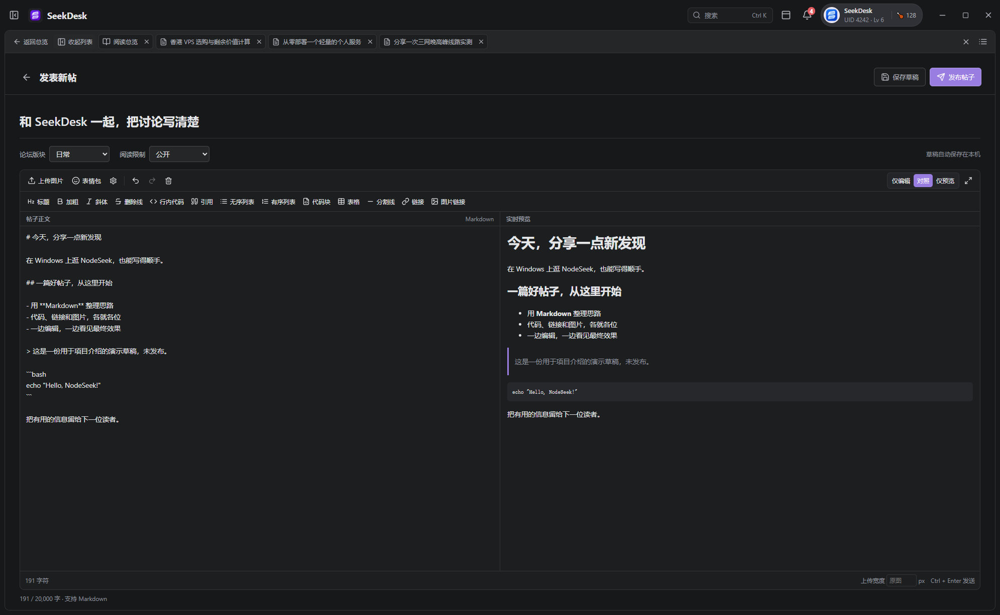
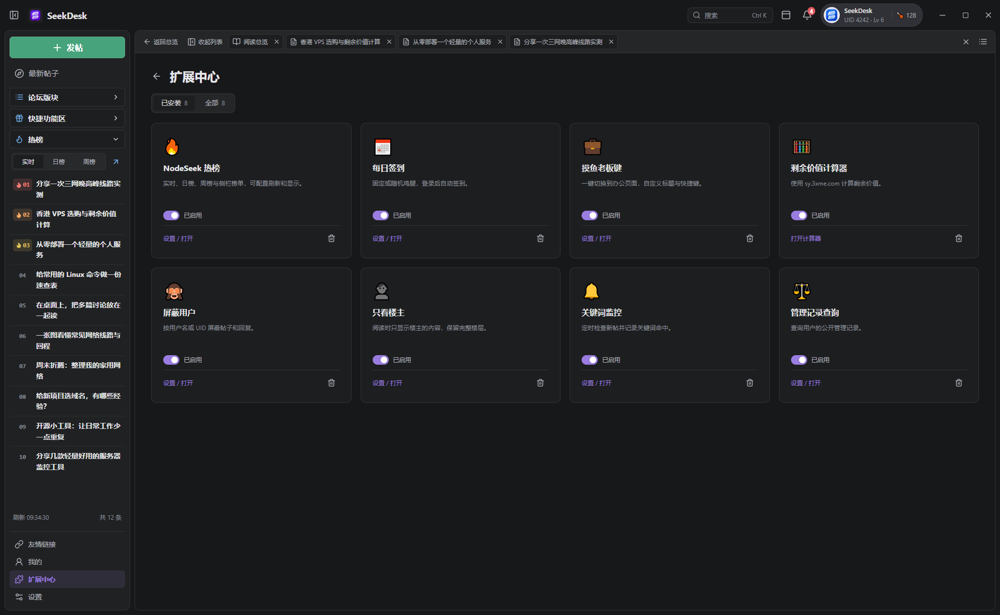
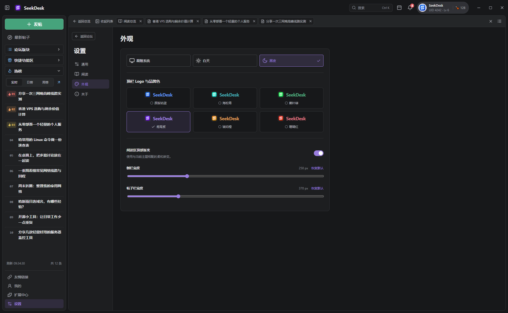
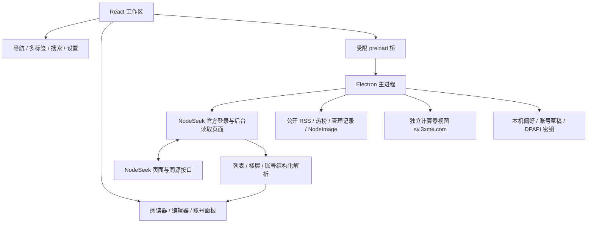

<p align="center">
  <picture>
    <source media="(prefers-color-scheme: dark)" srcset="assets/logo-dark.png">
    <source media="(prefers-color-scheme: light)" srcset="assets/logo-light.png">
    
  </picture>
</p>

<h1 align="center">SeekDesk Windows</h1>

<p align="center"><strong>在 Windows 上，舒服地逛 NodeSeek。</strong></p>
<p align="center">多栏找内容，多标签读帖子，需要表达时再展开编辑器。</p>

<p align="center">
  
  
  
  
  
  <a href="https://github.com/M1nt18/SeekDesk-Windows/actions/workflows/windows-source.yml"></a>
</p>

<p align="center">
  <a href="https://github.com/M1nt18/SeekDesk-Windows/releases/download/v0.1.1/SeekDesk-Windows-0.1.1-x64-Setup.exe">下载 Windows 安装包</a> ·
  <a href="https://github.com/M1nt18/SeekDesk-Windows">GitHub 项目</a> ·
  <a href="https://github.com/M1nt18/SeekDesk-Windows/releases/tag/v0.1.1">0.1.1 版本说明</a> ·
  <a href="https://github.com/M1nt18/SeekDesk-Windows/issues">问题反馈</a> ·
  <a href="https://www.nodeseek.com/">NodeSeek</a>
</p>

<p align="center">
  <a href="#about">认识项目</a> ·
  <a href="#screenshots">界面截图</a> ·
  <a href="#features">功能</a> ·
  <a href="#extensions">扩展</a> ·
  <a href="#getting-started">开始使用</a><br>
  <a href="#shortcuts">快捷键</a> ·
  <a href="#implementation">实现原理</a> ·
  <a href="#data">本机数据</a> ·
  <a href="#development">开发与测试</a> ·
  <a href="#faq">常见问题</a>
</p>

> [!IMPORTANT]
> **0.1.1 提供 Windows x64 安装包、免安装压缩包及配套源码。** 从 [Releases](https://github.com/M1nt18/SeekDesk-Windows/releases/tag/v0.1.1) 下载，并使用同页 `SHA256SUMS.txt` 校验文件。当前安装包未进行 Windows 代码签名。

> [!NOTE]
> **0.1.1 补齐本轮核对的 32 项问题**：当前页全部作者的等级在正文后逐步读取，帖子上下都有数字分页，个人主题恢复实际发帖时间，并补回资料卡、概况、通知正文预览、私信模式与状态隔离。详见 [0.1.1 更新内容](windows/docs/releases/v0.1.1.md) 与 [逐项核对记录](windows/docs/parity-audit.md)。

> **从旧版升级**：重新打包的 0.1.0 安装版可在“设置 → 关于”检查更新；早期没有更新器的 0.1.0 请直接下载安装 0.1.1。免安装版请完整下载新版。旧版说明保留于 [0.1.0 发布页](https://github.com/M1nt18/SeekDesk-Windows/releases/tag/v0.1.0) 与 [重新打包说明](windows/docs/DESKTOP-UNRELEASED.md)。

<a id="about"></a>

## 认识 SeekDesk Windows

SeekDesk Windows 是面向 **Windows 10 / 11 x64** 的第三方 NodeSeek 桌面客户端，基于 [@cshaizhihao 的 SeekDesk](https://github.com/cshaizhihao/SeekDesk) 开源项目移植。

Windows 版使用 **Electron + React + TypeScript** 重建工作区，沿用原版的导航组织和多栏阅读方式：左侧选择版块与工具，中间浏览帖子，右侧阅读正文和讨论；窗口变窄时可以专注阅读，多篇帖子留在独立标签中。官方登录页面保留在同一个客户端窗口内，与后台论坛读取共享登录会话。

Windows 移植维护：[@M1nt18](https://github.com/M1nt18)。原版 SeekDesk 作者：[@cshaizhihao](https://github.com/cshaizhihao)。版本变更见 [CHANGELOG](CHANGELOG.md)，原版说明保留于 [README.macOS.md](README.macOS.md)。

| 读得清楚 | 写得顺手 | 工具就近 |
| --- | --- | --- |
| 多栏、多标签、独立字号、NQ / TQ 报告与图片查看器 | Markdown 工具、对照预览、楼层回复与引用、图片和表情 | 热榜、签到、关键词监控、屏蔽、管理记录和剩余价值计算器 |

本项目与 NodeSeek 官方没有隶属关系。帖子、账号权限、阅读等级和社区规则均以 [NodeSeek](https://www.nodeseek.com/) 为准。原版 macOS 的 Swift 源码保留在仓库中，Windows 应用源码位于 [`windows/`](windows/)。

<a id="screenshots"></a>

## 看看它的样子

以下截图来自 Windows 客户端的实际运行界面，使用演示账号与示例内容展示布局。

### 多栏阅读，保留多篇讨论

侧栏、热榜、帖子列表和阅读区放在同一个工作区。回帖编辑器默认收起，把空间留给内容；需要回复时点击醒目的“写回复”，也可以从指定楼层直接回复或引用。


<details>
<summary><strong>查看浅色阅读界面</strong></summary>


</details>

### 编辑与预览并排显示

写作区使用完整内容宽度，标题、版块和阅读权限放在上方。格式工具直接可见，图片、表情、编辑模式和预览集中在同一个编辑器里。



<details>
<summary><strong>展开查看：扩展中心与外观设置</strong></summary>

内置八项扩展，按需要安装、启用、停用或移除。



白天、黑夜、跟随系统，以及六种品牌配色；各阅读区域的尺寸可独立调整。



</details>

<a id="features"></a>

## 日常逛坛，用得上的功能

### 浏览与阅读

- **帖子列表**：最新帖子、最新回复、论坛版块、精品区、手动刷新与分页；可选择自动刷新首页和滚动到底部加载更早的帖子。
- **公开 RSS 备用**：官网列表暂时不可读取时，使用公开 RSS 展示最近公开内容，清楚标记来源和摘要范围。
- **多标签阅读**：点击打开、Ctrl + 点击或中键后台打开，拖动排序，关闭当前或全部标签；阅读总览可以关闭和重新打开。
- **阅读位置恢复**：保留标签顺序、当前分页和滚动位置；从设置、扩展中心、个人页面返回时继续阅读，也可恢复上次打开的标签。
- **灵活布局**：调整侧栏和帖子栏宽度，收起列表或侧栏，切换三栏、列表与正文、专注阅读；窄窗口切换到阅读区。
- **楼层信息**：显示头像、等级、角色、楼主标记、时间和楼层。正文先显示，再为当前页全部可识别作者读取资料；取消原先仅 8 位作者的上限，失败可重试，完成官方验证后可继续读取。
- **上下数字分页**：楼主正文之后、跟帖之前以及末条回复之后都有页码与前后箭头，可直接回第一页；只使用站点提供的分页信息，切页清除旧楼层定位。
- **作者资料卡**：点击作者先查看轻资料卡，展示公开等级、角色、统计、加入时间和简介，再进入个人主页或私信。
- **清晰分区**：主楼、回复和签名分开排版。签名不加标题或背景，通过虚线与正文分隔；签名链接为绿色，普通文字为灰色，正文超链接为蓝色。
- **图片与复杂内容**：表格、代码、折叠内容、图片放大、前后切图、旋转、缩放、自适应、实际尺寸、保存和复制图片。
- **NQ / TQ 报告**：识别 ANSI 彩色终端与网页终端原文，保留完整报告并支持完整复制；报告标签可切换，NQ 与 TQ 的缩放分别记忆。

### 搜索帖子与用户

- 搜索帖子和论坛用户，选择一个或多个版块，保存最近搜索记录。
- 在当前列表中快速筛选标题、作者和版块。
- 本地匹配统一大小写、全半角与重音形式；部分英文或数字关键词支持轻度拼写容错。
- 粘贴 NodeSeek 帖子链接直接打开，可保留指定分页和楼层。

完整历史搜索及部分用户信息的读取，仍受论坛登录状态和账号权限限制。

### 写作与互动

- **发帖与编辑**：选择版块和阅读权限，发布新主题；加载原始 Markdown，编辑当前账号有权修改的主题或评论。
- **统一 Markdown 编辑器**：发帖、回帖和 Markdown 私信共用标题、加粗、斜体、删除线、行内代码、代码块、引用、列表、表格、分隔线、链接等工具，支持撤销和重做；纯文本私信使用普通输入框。
- **三种视图**：仅编辑、编辑与预览对照、仅预览；编辑区高度可调整，也可展开编辑区。
- **回复与引用独立**：“回复”带入作者和楼层链接；“引用”同时带入原文。操作后打开编辑器并聚焦到草稿末尾。
- **默认收起回帖区**：浏览时不占用大块阅读空间，点击“写回复”再展开；成功发布后收起并定位新楼层。
- **回复后及时定位**：按官方返回的目标页与楼层读取新评论；遇到短暂同步延迟只重试读取，不重复提交已经确认成功的回复。开启“只看楼主”时，也能临时看到自己刚发布的新楼层。
- **帖子互动**：点赞、送鸡腿、点踩、关注和取关；涉及免费额度或鸡腿消耗的操作先确认，再由站点校验。

### 图片与表情

- 选择本地图片，或在编辑器粘贴、拖入图片，上传后插入 Markdown。
- 配置自己的 [NodeImage](https://www.nodeimage.com/) API Key，密钥使用 Windows DPAPI 加密保存。
- 使用 NodeSeek 官方表情，按组导入本机自定义表情；本机表情在插入时上传。
- 调整普通图片的上传宽度，也可在预览中调整发送尺寸；发送前生成相应副本并替换图片链接。处理失败时保留草稿。
- GIF 动图保留原始尺寸；阅读长图使用像素预算和有限缓存，可按需查看原图。

### 个人空间、通知与私信

- 个人空间默认展示概况与只读 README，可从统计卡进入主题、评论，以及本人的关注和粉丝列表。已发布主题显示实际发帖年月日与时分秒，列表先出现，时间随后补齐，失败可重试。
- 主题与评论列表使用独立行背景，主题不显示无意义的“#0”；保留角色标签、查看原页和账号设置入口。
- 编辑自己的个人介绍、个人 README 和帖子签名。
- 查看“@我”“回复”“私信”三类通知及各自未读数量；选择通知即可在通知页预览对应楼层正文，也可打开原帖。
- 浏览私信会话，按 UID 或个人主页链接打开会话，并按账号保存最近与较早联系人。进入长会话或发送成功后定位最新消息。
- 私信支持 Markdown 与纯文本读写，保留原消息格式；切换撰写模式不丢内容，草稿同时保存模式和图片尺寸。
- 回复、新主题、编辑内容和私信草稿按已确认账号保存，包含图片尺寸设置；切换账号时隔离草稿并清理关联阅读缓存。

### 外观与阅读设置

- **三种主题**：白天、黑夜、跟随系统。
- **六种品牌色**：钴蓝、海松青、蕨叶绿、鸢尾紫、琥珀橙、珊瑚红，联动顶栏标识与运行中的任务栏图标。
- **全局界面字号 14–28**，正文基础字号 **14–40**；帖子列表、作者栏、论坛版块、热榜和报告尺寸分别调整，并提供预览。
- 彩色版块、等级和角色标记，热榜前三名图标、加粗标题、更新时间与总条数。
- 菜单支持点击空白或按 Esc 关闭；收起帖子列表的选择可记忆，窄屏临时收起不覆盖该偏好。页面动效遵循系统“减少动态效果”偏好。

<a id="extensions"></a>

## 扩展中心：八项常用工具

默认安装并启用热榜，其余工具按需要添加。配置保存在本机；停用或移除扩展会同步停止对应的自动任务或阅读筛选。

| 扩展 | 能做什么 | 使用条件 |
| --- | --- | --- |
| 🔥 NodeSeek 热榜 | 实时榜、日榜、周榜，侧栏与完整榜单；设置默认榜单、侧栏条数、刷新间隔和热度分值显示 | 使用社区公开榜单服务 |
| 📅 每日签到 | 固定或运气签到，可设置北京时间零点自动签到；按账号与日期记录结果 | 已登录、客户端运行、站点允许操作 |
| 💼 摸鱼老板键 | 将客户端切换为工作表外观，自定义标题、返回按钮和快捷键 | 在扩展设置中配置 |
| 🧮 剩余价值计算器 | 在主窗口内打开 [sy.3xme.com](https://sy.3xme.com/)，计算续费剩余价值、汇率与挂价差额，生成 MD 图片链接 | 使用独立网站，输入记录独立保存在本机 |
| 🙈 屏蔽用户 | 按 UID 或用户名折叠正文和回复，保留楼层；可临时展开或解除 | 本机配置，不修改官网账号黑名单 |
| 👤 只看楼主 | 聚焦主题作者的正文与后续回复 | 在帖子阅读时使用 |
| 🔔 关键词监控 | 运行期间约每 10 秒检查公开 RSS，记录命中、显示应用内提醒，可启用系统通知 | 受 RSS 范围、网络和 Windows 通知状态影响 |
| 📋 管理记录查询 | 从作者旁或扩展面板查询公开管理记录，查看来源帖子 | 使用 NS Seek 社区服务 |

### 热榜设置

热榜的“设置 / 打开”提供四项配置：

| 设置 | 可选范围 |
| --- | --- |
| 默认榜单 | 实时、日榜、周榜 |
| 侧栏显示条数 | 5–30 条 |
| 自动刷新间隔 | 按面板提供的间隔选择，范围为 60–1800 秒 |
| 显示热度分值 | 开启或关闭 |

侧栏左下显示刷新时间，右下显示榜单总条数；周榜旁的箭头打开完整榜单。手动刷新会重新请求，自动刷新按保存的间隔执行。

### 关键词规则

用逗号分组，用 `+` 连接同组必含词。例如：

```text
香港+VPS, 日本+软银, 优惠
```

表示匹配“同时包含香港和 VPS”，或“同时包含日本和软银”，或“包含优惠”的公开订阅内容。客户端按帖子 ID 去重，保留命中记录；收到提醒后可以直接打开帖子。

自动签到和关键词监控依赖客户端运行，退出程序后不会继续执行。电脑休眠、断网、站点验证或服务限流都会影响执行时间。

## 可选：NodeSeek Pro

除八项内置扩展外，客户端集成 **Woodll 的 Nodeseek Pro 1.0.8**，来源为 [GreasyFork 567109](https://greasyfork.org/scripts/567109-nodeseek-pro)。

在“设置 → 通用”启用后，脚本运行于客户端中的 **NodeSeek 官方网页**；通过“打开脚本设置”进入菜单和原版高级设置。脚本初始关闭，集成时的自动签到初始也关闭。

脚本作用于官方网页 DOM，不在 React 重建的列表和阅读器中运行。本项目提供的是针对该固定版本的兼容环境，并非通用 Tampermonkey 加载器。固定源文件、许可、资源及兼容边界见 [NodeSeek Pro 集成说明](windows/docs/NODESEEK-PRO.md)。

<a id="getting-started"></a>

## 开始使用

### 下载安装

1. 下载 [SeekDesk-Windows-0.1.1-x64-Setup.exe](https://github.com/M1nt18/SeekDesk-Windows/releases/download/v0.1.1/SeekDesk-Windows-0.1.1-x64-Setup.exe)，运行后选择安装位置。无需另外安装 Node.js。
2. 或下载 [免安装压缩包](https://github.com/M1nt18/SeekDesk-Windows/releases/download/v0.1.1/SeekDesk-Windows-0.1.1-x64-portable.zip)，完整解压到一个文件夹，运行其中的 `SeekDesk Windows.exe`；请保留旁边的资源和依赖文件。
3. 当前安装包未进行 Windows 代码签名，首次运行可能显示“未知发布者”。请从本仓库下载，并可用 `certutil -hashfile 文件名 SHA256` 核对发布页校验值。

发布文件经过包内容检查：不携带维护者的论坛登录、Cookie、草稿、API Key、测试目录或本机调试日志。首次运行会在使用者自己的系统中建立独立配置。

### 系统与源码运行

面向 **Windows 10 / 11 x64**。从源码运行需要 Node.js **22.12 或更高版本**及 npm；首次安装依赖需要网络。

在 cmd.exe 中获取源码并运行：

```bat
git clone https://github.com/M1nt18/SeekDesk-Windows.git
cd SeekDesk-Windows
cd windows
npm ci
npm run build
npm start
```

`npm run build` 进行 TypeScript 检查、React 构建和 Electron 编译，**不会生成安装包**。已有编译结果时，也可双击 `windows/启动调试版.cmd` 启动；更新源码后应重新执行构建，再退出并重新启动旧进程。

### 第一次使用

1. 从“最新帖子”或“论坛版块”开始浏览，点击帖子进入阅读；用 Ctrl + 点击在后台保留其他帖子。
2. 点击右上账号，在客户端内的 **NodeSeek 官方登录页**完成登录或人工验证。登录弹窗留在主窗口内，识别成功后返回阅读界面。
3. 点击“＋ 发帖”进入写作区；在帖子底部点击“写回复”，或使用楼层上的“回复”“引用”入口。
4. 需要上传图片时，打开编辑器的图床设置，填写自己的 NodeImage API Key；普通文字编辑不需要图床密钥。
5. 在“设置 → 阅读”调整字号和报告大小，在“设置 → 外观”选择主题与品牌色。
6. 到“扩展中心”安装需要的工具。计算器使用独立网站存储，重新打开后可继续使用上次的输入。

### 登录、权限与更新

客户端使用自己的 Chromium 网站存储，与 Edge、Chrome 的个人资料分开。浏览器中已登录，不代表客户端已经登录；客户端不会导入外部浏览器 Cookie。

账号等级、受限版块、历史搜索、发帖频率和互动额度仍由 NodeSeek 校验。遇到登录失效或站点验证时，可回到官方页面处理。

**0.1.1 安装版支持在线更新。** 更新来自本仓库 GitHub 稳定发布，使用 `latest.yml` 清单和 SHA-512 校验，可取消下载、重启续装并清理应用更新缓存。重新打包的 0.1.0 安装版可直接检查并更新到 0.1.1；早期没有更新器的 0.1.0 请手动下载安装新版。免安装版通过 [Releases](https://github.com/M1nt18/SeekDesk-Windows/releases/tag/v0.1.1) 手动下载。

<a id="shortcuts"></a>

## 常用快捷键

| 操作 | Windows 快捷键 |
| --- | --- |
| 搜索帖子、用户或打开帖子链接 | `Ctrl + K` |
| 刷新帖子列表；专注阅读时刷新当前帖 | `Ctrl + R` |
| 列表选择上一帖 / 下一帖 | `↑` / `↓` |
| 打开选中的帖子 | `Enter` |
| 后台打开帖子 | `Ctrl + Enter`、`Ctrl + 点击` 或鼠标中键 |
| 关闭当前帖子标签；在官方页面返回阅读 | `Ctrl + W` |
| 下一个 / 上一个标签 | `Ctrl + Tab` / `Ctrl + Shift + Tab` |
| 关闭菜单、搜索或当前面板，返回列表 | `Esc`，视当前位置而定 |
| 打开设置 | `Ctrl + ,` |
| 老板键 | `Ctrl + Shift + 配置的字母或数字`，默认 `9` |
| 编辑器加粗 / 斜体 / 链接 | `Ctrl + B` / `Ctrl + I` / `Ctrl + K` |
| 撤销 / 重做 | `Ctrl + Z` / `Ctrl + Shift + Z` 或 `Ctrl + Y` |

回复发送方式可在设置中选择 **Ctrl + Enter**、**Enter** 或 **仅按钮发送**。选择 Enter 发送时，用 Shift + Enter 换行；输入法组词期间不会把回车误当发送。

<a id="implementation"></a>

## 它是怎样实现的？

React 负责用户看到的工作区，Electron 管理窗口、系统功能与网站会话。后台论坛页面把帖子和账号数据转换为结构化内容，React 再将其显示为列表、楼层、编辑器和通知。RSS、榜单、图床及计算器使用各自的服务与存储边界。



<details>
<summary><strong>官方会话、请求结果与回复定位</strong></summary>

官方登录视图和后台读取页共享 `persist:nodeseek` 分区。论坛写操作在 NodeSeek 网页上下文发起同源请求，站点负责最终权限校验；应用不把论坛 Cookie 字符串交给 React 或外部服务。

每次写操作携带发起时的账号标识，账号变化会使旧操作和关联读取结果失效。请求超时但结果未知时不会自动重发，避免重复帖子、私信或互动。

回复确认成功后，客户端保留官方返回的目标链接和楼层，计算对应分页并定位；后台读取页禁用缓存，楼层 hash 不会代替文档刷新。新楼层尚未同步时仅有限重试 GET，始终不重发已接受的 POST。

</details>

<details>
<summary><strong>正文、终端报告与图片</strong></summary>

论坛页面中的正文、作者信息、分页、签名和互动状态被提取为结构化数据，经过内容白名单净化后渲染。代码、表格、折叠块和图片保持原有顺序。

终端报告支持 ANSI 基础色、256 色、RGB 色与加粗。在网页终端替换原始内容前尽早保留报告原文，避免只读到终端当前可见的几行。NQ 长报告按宽度向下展开，TQ 按阅读区大小缩放，二者分别保存比例。

阅读图片按像素预算生成显示版本并使用有限缓存；用户可按需打开原图。普通图片调整发送尺寸时，客户端缩图、重新上传并只替换对应图片地址，保留普通链接和代码中的相同字符串。

</details>

<details>
<summary><strong>扩展与计算器的运行方式</strong></summary>

热榜按周期保存快照并合并重复请求，失败时可保留旧结果；手动刷新和自动刷新采用各自的刷新时机。

关键词监控使用公开 RSS，保存 `ETag`、`Last-Modified` 条件头，按帖子 ID 去重。遇到限流或暂时失败时，结合 `Retry-After` 和退避延后读取。

签到按北京时间划分日期，核对账号和已完成记录；自动任务只在客户端运行期间执行。

剩余价值计算器是 `https://sy.3xme.com/` 的独立 `WebContentsView`，不接收论坛登录会话，也不能调用应用 IPC。它的输入记录保存在独立 `persist:calculator` 分区，计算与 MD 输出由网站提供。

</details>

<a id="data"></a>

## 本机数据保存在哪里？

默认数据目录为 Electron 的用户数据目录，Windows 上通常是：

```text
%APPDATA%\seekdesk-windows
```

| 内容 | 保存或处理方式 |
| --- | --- |
| 主题、字号、标签顺序、分页与阅读位置 | `preferences.json`；可关闭标签恢复 |
| 扩展设置、搜索历史、关键词命中与账号草稿 | `workspace-features.json`；草稿按已确认账号 ID 隔离 |
| NodeSeek 登录会话 | Chromium 管理的 `Partitions/nodeseek/` |
| 计算器输入记录 | 独立的 `Partitions/calculator/` 网站存储 |
| NodeImage API Key | `media.json` 中保存 Windows DPAPI 加密后的内容，不将明文密钥返回界面 |
| 本机表情 | `stickers/`，预览使用缩略图，插入时才上传；本机总大小上限 64 MB |
| NodeSeek Pro 设置 | 独立脚本存储，兼容说明见 [NODESEEK-PRO.md](windows/docs/NODESEEK-PRO.md) |
| 近期正文与阅读图片 | 有容量限制的进程内缓存，不构成完整离线资料库 |

本地草稿与偏好文件不是加密保险箱，请避免长期保存密码或其他敏感内容。“清除会话”会清理客户端内的 NodeSeek 会话和关联阅读状态；它不会导入或清除外部浏览器的登录资料。

<a id="development"></a>

## 开发、构建与测试

### 日常开发

在仓库根目录使用 cmd.exe：

```bat
cd windows
npm ci
npm run dev
```

开发命令启动 Vite 和 Electron。React 界面支持热更新；修改主进程或 preload 后，重新启动开发命令。

### 编译当前源码

```bat
npm run build
npm start
```

构建输出为 `windows/dist/` 和 `windows/dist-electron/`。一般构建不需要 Swift、Xcode 或 Python。

<details>
<summary><strong>需要自行生成安装程序时</strong></summary>

工程保留 electron-builder 的 Windows x64 NSIS 配置：

```bat
npm run dist
```

该命令会构建并打包，输出到 `windows/release/`；它与普通的 `npm run build` 分开。维护者发布时显式关闭自动上传，在检查安装载荷和隐私内容后上传审核过的文件；当前安装程序未签名。

</details>

### 检查命令

以下命令在 `windows/` 目录运行：

```bat
npm run typecheck
npm test
npm run test:app
npm run test:feedback
npm run test:reply-refresh
npm run test:public
```

| 检查 | 覆盖内容 |
| --- | --- |
| `typecheck` | React、共享类型和 Electron 双侧 TypeScript 检查 |
| `test` | DOM/RSS 解析、URL 与输入边界、Markdown/ANSI、账号隔离、草稿、互动协议、扩展和图片地址处理 |
| `test:app` | 真实 Electron 中的主进程、preload、界面、编辑器、阅读器和登录回跳回归 |
| `test:feedback` | 菜单、配色、图标、热榜设置、签名、链接、友情链接和真实计算器的界面检查 |
| `test:reply-refresh` | 新回复跨页定位、延迟同步时只读重试、作者筛选下的可见性和刷新读取 |
| `test:public` | 实际匿名读取公开 RSS、热榜、管理记录和汇率服务 |

0.1.1 的当前验证包括 **177 项单元与契约测试**，以及 Electron 的资料/分页、个人空间、通知私信、界面、会话、阅读器、桌面和回复刷新回归。论坛写操作和 NodeImage 上传使用独立测试替身，不向真实论坛发布测试内容。

本轮匿名实读公开帖子成功，取得正文楼层及数字分页；同一匿名会话的用户资料接口返回 403 站点验证页，因此没有将真实线上等级读取记作成功。遇到这一情况，正文仍可阅读，资料可在官方窗口完成登录或验证后重试。

GitHub Actions 在 Windows 环境执行依赖安装、单元测试和源码编译。安装包生成、内容检查与上传由维护者单独执行，不会由首次推送自动触发旧 macOS 发布流程。

真实账号登录、人工验证、受限内容及线上写权限仍需在自己的官方会话下验收。0.1.1 本轮的详细范围见 [原版核对与验证记录](windows/docs/parity-audit.md)；较早记录保留于 [历史验收记录](windows/docs/VERIFICATION-CURRENT.md) 与 [功能对照](windows/docs/FEATURE-PARITY.md)。

### 工程结构

| 路径 | 主要职责 |
| --- | --- |
| `windows/src/` | React 工作区、阅读器、Markdown 编辑器、账号与扩展界面、样式 |
| `windows/electron/` | 窗口、官方会话、论坛解析与操作、扩展任务、图片处理、本机存储和脚本兼容 |
| `windows/shared/` | 主进程与界面共用的类型和 API 契约 |
| `windows/tests/`、`windows/scripts/` | 单元测试、Electron 回归、公开读取检查与开发脚本 |
| `windows/vendor/nodeseek-pro/` | 固定版本脚本、依赖资源、来源和许可 |
| `windows/docs/` | 功能对照、NodeSeek Pro 说明与验证记录 |
| `Sources/`、`Tests/` | 原版 macOS 的 Swift 源码与测试，作为移植参考保留 |

Windows 的版本以 `windows/package.json` 与 `v0.1.1` 标签为准。根目录 `VERSION`、`BUILD_NUMBER` 属于保留的 macOS 参考构建，原工作流存档在 `docs/upstream-workflows/`，不会执行。

<a id="faq"></a>

## 常见问题

<details>
<summary><strong>这是原版 SeekDesk 的 Windows 官方版吗？</strong></summary>

这是基于原版开源代码的 Windows 移植项目，采用 Electron、React 和 TypeScript 实现。原版 SeekDesk 由 NodeSeek @cshaizhihao 开发，面向 macOS；原项目地址和许可保留在本仓库声明中。

</details>

<details>
<summary><strong>浏览器已经登录，为什么还要在客户端登录？</strong></summary>

客户端使用独立的 Chromium 网站数据存储，不读取 Edge、Chrome 等浏览器的个人资料。首次使用或会话失效时，需要在客户端内的官方页面登录。

</details>

<details>
<summary><strong>为什么有时只显示摘要，或看不到更早的帖子？</strong></summary>

官网暂时无法读取时，客户端可回退到公开 RSS。RSS 仅提供最近公开订阅内容，通常不包含完整回复、全部历史或受限帖子。界面会标记“公开 RSS”和摘要提示；完成官方验证后可重新读取。

</details>

<details>
<summary><strong>回复确认成功后为什么还可能短暂等待？</strong></summary>

客户端会跳到官方返回的新评论分页，并重新读取目标楼层。如果站点尚未同步新楼层，会短暂重试读取并提示当前状态；这个过程不会重发已经确认成功的回复。出现结果未知的错误时，请先刷新核实再决定是否重试。

</details>

<details>
<summary><strong>是否必须配置 NodeImage 密钥？</strong></summary>

普通浏览、文字发帖和文字编辑不需要。通过客户端上传图片、插入本机自定义表情，或发送缩小后的图片副本时，需要配置自己的 NodeImage API Key。

</details>

<details>
<summary><strong>退出程序后自动签到和关键词提醒还会执行吗？</strong></summary>

不会。它们依赖客户端进程，没有独立常驻服务或云端代跑任务。睡眠、断网和站点验证也可能延后执行。

</details>

<details>
<summary><strong>能导入任意浏览器脚本或第三方插件吗？</strong></summary>

扩展中心管理的是八项内置工具。NodeSeek Pro 是额外适配的固定版本脚本，目前没有通用插件加载或任意油猴脚本导入功能。

</details>

<details>
<summary><strong>是否支持离线、云同步或自动更新？</strong></summary>

当前提供本机草稿、偏好与有限阅读缓存，没有完整离线论坛或跨设备同步。0.1.1 安装版及重新打包的 0.1.0 安装版可从本仓库检查新版，由用户确认下载和安装；早期没有更新器的 0.1.0 请手动下载安装 0.1.1，免安装版从 Releases 下载完整新版。

</details>

## 开源与致谢

源码采用 **GPL-3.0-only**，见 [LICENSE](LICENSE)。Windows 移植保留原作者署名和许可要求；分发修改版时，应提供匹配的完整源码、许可及第三方声明。

- **原版 SeekDesk**：NodeSeek @cshaizhihao / GitHub [@cshaizhihao](https://github.com/cshaizhihao)，[原项目与源码](https://github.com/cshaizhihao/SeekDesk/tree/main?tab=readme-ov-file)。
- **NodeSeek**：提供社区内容、账号体系与站点功能。
- **NodeSeek 热榜**：@小号的[热榜项目](https://greasyfork.org/scripts/560065)及其公开榜单服务。
- **管理记录**：@slugger 的[原脚本](https://greasyfork.org/scripts/567915)与 [NS Seek 后端](https://github.com/theslugger/ns-seek)，以及相关社区改进。
- **剩余价值计算器**：[sy.3xme.com](https://sy.3xme.com/)。
- **NodeImage**：[图片托管服务](https://www.nodeimage.com/)。
- **Nodeseek Pro**：Woodll 的 [1.0.8 用户脚本](https://greasyfork.org/scripts/567109-nodeseek-pro)。
- **基础项目**：Electron、Chromium、Node.js、React、TypeScript、Vite、Lucide，以及本项目使用的解析、净化和图片处理依赖。

品牌标识、伙伴标识及截图中的内容归相应权利人所有。第三方代码、服务与素材说明见 [Windows 声明](windows/NOTICE.md) 和 [原版第三方声明](THIRD_PARTY_NOTICES.md)。

## 友情链接

| 伙伴 | 简介 | 访问 |
| --- | --- | --- |
| <br>**Impart** | 全球自建家宽测速，VPS 与 IDC、银行卡、电话卡交流与优惠。 | [Telegram 群组](https://t.me/Impart_Cloud) |

---

<p align="center">SeekDesk Windows · 0.1.1</p>
<p align="center">让阅读、切换和表达，在同一个窗口里继续。</p>
