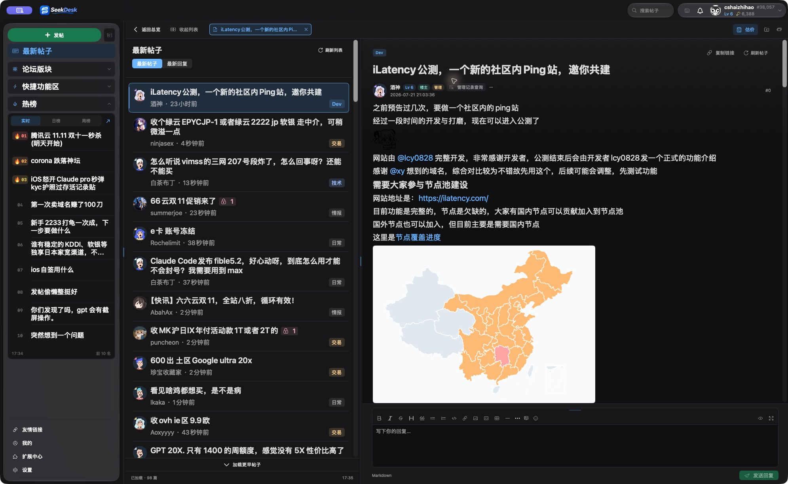
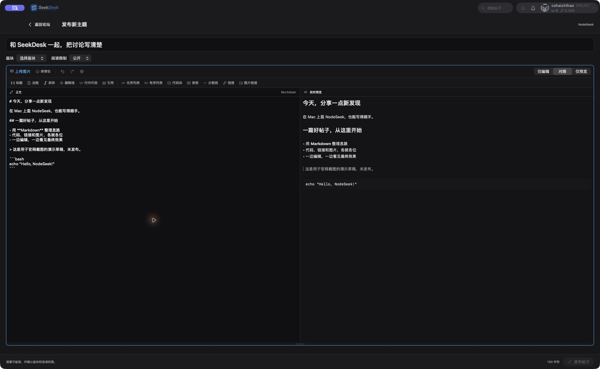
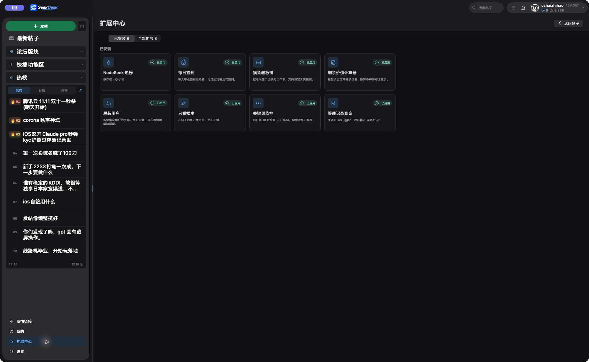
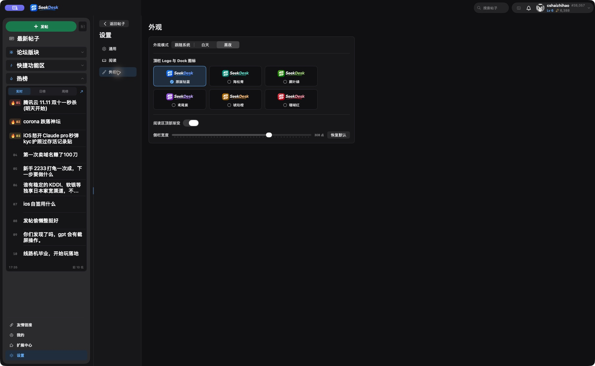
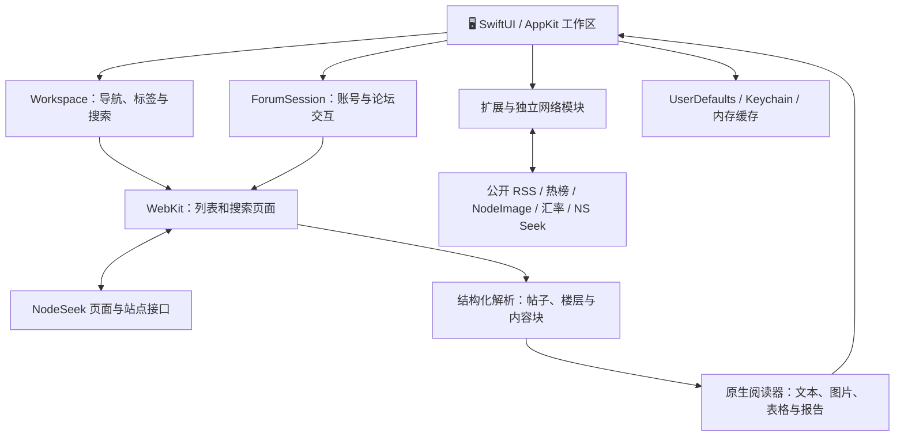

<p align="center">
  <picture>
    <source media="(prefers-color-scheme: dark)" srcset="assets/logo-dark.png">
    <source media="(prefers-color-scheme: light)" srcset="assets/logo-light.png">
    
  </picture>
</p>

<h1 align="center">SeekDesk</h1>

<p align="center"><strong>🖥️ 在 Mac 上，舒服地逛 NodeSeek。</strong></p>
<p align="center">多帖随手切换，讨论从容展开。把逛坛这件小事，做得顺手一点。</p>

<p align="center">
  
  
  
  
</p>

<p align="center">
  🌐 <a href="https://seekdesk.com/">官网（建设中）</a> ·
  📦 <a href="https://github.com/cshaizhihao/SeekDesk">GitHub</a> ·
  💬 <a href="https://github.com/cshaizhihao/SeekDesk/issues">反馈问题</a> ·
  🐔 <a href="https://www.nodeseek.com/">NodeSeek 社区</a>
</p>

> [!IMPORTANT]
> 🚧 **开发进行中**：本仓库目前公开项目介绍、Logo 与真实应用截图。源码、安装包和 Release 将在修复与验收完成后发布。下文介绍当前开发版的功能和实现方式，不代表正式版已经发行；源码计划采用 **GPL-3.0-only**。

<p align="center">
  <a href="#about">认识 SeekDesk</a> ·
  <a href="#screenshots">真实截图</a> ·
  <a href="#features">功能</a> ·
  <a href="#extensions">扩展</a> ·
  <a href="#usage">使用指南</a><br>
  <a href="#comparison">网页版对比</a> ·
  <a href="#implementation">实现原理</a> ·
  <a href="#faq">常见问题</a> ·
  <a href="#opensource">开源计划</a> ·
  <a href="#friends">友情链接</a>
</p>

<a id="about"></a>

## 👋 认识 SeekDesk

在交易帖里算一笔剩余价值，打开几篇测评对照线路，写一段回复，再看一眼热榜——这些都是逛 NodeSeek 时很自然的动作。SeekDesk 希望把它们放进一个适合 Mac 的工作区，让阅读、切换和表达更连贯。

**SeekDesk 是面向 macOS 的第三方 NodeSeek 客户端。** 它使用 Swift、SwiftUI 和 AppKit 构建原生界面：左侧找内容，中间看列表，右侧读帖子；窗口变窄时切换阅读，想专注时收起列表，多篇帖子则留在独立标签里。

| 📖 读得舒服 | ✍️ 写得顺手 | 🧩 工具就近 |
| --- | --- | --- |
| 多栏与多标签、独立字号、NQ / TQ 报告缩放 | Markdown 对照预览、图片上传、表情和楼层引用 | 热榜、剩余价值计算、签到、关键词监控 |

**作者：NodeSeek @cshaizhihao** · GitHub：[@cshaizhihao](https://github.com/cshaizhihao)

SeekDesk 独立开发，与 NodeSeek 官方没有隶属关系。登录通过应用内的官方页面完成，帖子、私信、等级与操作权限均沿用 [NodeSeek](https://www.nodeseek.com/) 的账号体系和社区规则。

<a id="screenshots"></a>

## 🖼️ 看看它的样子

以下均为应用的真实运行截图。论坛内容、功能细节和布局会随开发进度变化。

### 📖 多栏阅读，随时切换

侧栏导航、热榜、帖子列表和正文放在同一个窗口里。既能扫一眼社区的新讨论，也能留在当前帖子继续读；返回总览后，已经打开的标签仍然保留。



### ✍️ 一边写，一边看效果

写作区使用完整内容宽度，格式工具直接可见。标题、版块与阅读权限集中在上方，正文和预览并排显示，插入图片和表情后可以继续调整内容。



<details>
<summary><strong>🧩 展开查看更多：扩展中心与六色外观</strong></summary>

按需要添加、启用、停用或移除内置工具。



白天、黑夜或跟随系统；六种 Logo 配色与运行中的 Dock 图标联动。



</details>

<a id="features"></a>

## ✨ 日常逛坛，用得上的功能

### 📚 浏览与阅读

- **原生帖子列表**：最新帖子、最新回复、版块筛选、精品区、刷新与分页；首页列表不可用时可回退读取公开 RSS。
- **独立帖子标签**：点击打开、⌘ 点击后台打开、拖动排序、关闭当前标签和关闭全部；返回总览后保留已打开标签。
- **自适应布局**：宽窗口显示多栏，窄窗口切换到阅读区；侧栏与列表宽度可调整，也可以收起帖子列表。
- **楼层阅读**：显示头像、等级、角色、签名、楼层和分页；支持表格、图片放大，以及回复、引用和楼层定位。
- **NQ / TQ 报告**：彩色终端报告与测评图片有专门的展示方式，缩放独立记忆；NQ 长报告按宽度展开，长度随内容自然延伸。长图与超长报告是当前重点回归场景。
- **搜索帖子与用户**：可选多个版块、保留最近搜索，也可粘贴 NodeSeek 帖子链接直接打开；历史搜索需要相应登录权限。

### 💬 写作与互动

- **Markdown 编辑器**：发帖、回复和私信共用格式工具，支持编辑、对照和预览模式；编辑区高度可拖动调整。
- **图片与表情**：本地选图、剪贴板图片上传、NodeSeek 官方表情，以及可分组导入的本机表情；支持调整普通图片的发送尺寸。
- **帖子互动**：回复、引用、点赞、送鸡腿、点踩，以及编辑自己有权修改的主题和评论；操作权限由 NodeSeek 校验。
- **个人空间**：查看主题、评论、粉丝和关注，编辑自己的个人 README 与帖子签名。
- **通知与私信**：查看 @我、主题回复和私信，跳转对应帖子或楼层；可按 UID 或个人主页链接打开私信会话。

### 🎨 外观与阅读设置

- 白天、黑夜与跟随系统；在支持的系统上使用 macOS Liquid Glass。
- 六种品牌配色：原版钴蓝、海松青、蕨叶绿、鸢尾紫、琥珀橙、珊瑚红。
- 帖子列表、正文、作者栏、侧栏版块和热榜均可调整阅读尺寸，并提供实时预览。
- 从设置、扩展中心或个人页面返回原帖，继续阅读；动效遵循系统的“减少动态效果”设置。

<a id="extensions"></a>

## 🧩 扩展中心：把常用工具放在手边

从八种内置工具中选择自己需要的功能，添加后即可启用，也能随时停用或移除。配置在本机保存；热榜默认启用，其余工具可按自己的习惯搭配。

| 扩展 | 能做什么 | 使用条件 |
| --- | --- | --- |
| 🔥 NodeSeek 热榜 | 实时榜、日榜、周榜；侧栏前十名与完整榜单 | 使用社区公开热榜服务 |
| 🍗 每日签到 | 固定或运气签到，可设置北京时间零点自动签到 | 已登录，应用保持运行，站点允许操作 |
| 🗂️ 摸鱼老板键 | 将论坛窗口切换为工作表外观，支持自定义快捷键 | 在扩展设置中配置 |
| 🧮 剩余价值计算器 | 按续费周期和剩余天数估价，换算币种并对比挂价 | 汇率可在线获取，也可手动输入 |
| 🙈 屏蔽用户 | 折叠指定用户正文和回复，保留楼层位置，可临时展开或解除 | 本机配置 |
| 👤 只看楼主 | 聚焦主题作者的正文与回复 | 在帖子阅读时使用 |
| 🔔 关键词监控 | 运行期间约每 10 秒检查 RSS，命中后弹窗，可启用系统通知 | 受公开 RSS 范围、网络状态和通知授权影响 |
| 📋 管理记录查询 | 从作者旁查询社区管理记录并查看来源帖子 | 使用 NS Seek 社区服务 |

扩展中心管理的是应用内置工具。目前没有通用的第三方插件加载接口，浏览器油猴脚本也不能直接导入运行。

关键词监控支持多组规则，用逗号分组、用 `+` 连接同组必含词。例如：

```text
香港+VPS, 日本+软银, 优惠
```

表示匹配“同时包含香港和 VPS”，或“同时包含日本和软银”，或“包含优惠”的公开订阅内容。

<a id="usage"></a>

## 🚀 使用指南

### 📦 获取应用与系统要求

目前处于开发和审查阶段，**尚无公开安装包**。后续下载和版本说明将统一放在本仓库的 [Releases](https://github.com/cshaizhihao/SeekDesk/releases)；正式发布后，再补充对应版本的安装与校验说明。

首版面向 **Apple Silicon Mac**，项目设定的系统目标是 **macOS 14 及以上**。当前预览主要在 Apple Silicon 的新版 macOS 环境验证，旧系统兼容性仍在核对；Liquid Glass 效果需要 macOS 26 及以上。Intel Mac、Windows 和 Linux 暂未提供发行版。

### 🧭 第一次使用，可以这样开始

1. 从“最新帖子”或“论坛版块”开始浏览，点击帖子进入阅读；用“返回总览”回到列表。
2. 点击右上角账户图标，在应用内打开 **NodeSeek 官方登录页**。登录后的读取与互动仍受站点等级、阅读权限和账号状态限制。
3. 点击“＋ 发帖”进入写作区，选择版块和阅读权限；在帖子底部回复，或用楼层上的入口引用内容。
4. 上传图片时，在编辑器的图床设置中配置自己的 [NodeImage](https://www.nodeimage.com/) 密钥。密钥保存在 macOS 钥匙串；本机导入的自定义表情在插入时才上传。
5. 在“设置 → 阅读”中调整字号、作者栏与报告缩放；在“设置 → 外观”中选择主题和 Logo 配色。
6. 在“扩展中心”添加需要的工具。关键词监控、自动签到等任务依赖客户端运行，退出应用后不会继续执行。

### ⌨️ 常用快捷键

| 操作 | 快捷键 |
| --- | --- |
| 搜索或打开 NodeSeek 帖子链接 | `⌘ K` |
| 刷新帖子列表 | `⌘ R` |
| 列表中选择上一帖 / 下一帖 | `↑` / `↓` |
| 打开选中的帖子 | `Return` |
| 在后台打开帖子 | `⌘ Return` 或 `⌘ 点击` |
| 关闭当前帖子标签 | `⌘ W` |
| 切换到下一个 / 上一个标签 | `⌃ Tab` / `⌃ ⇧ Tab` |
| 返回列表或关闭当前搜索面板 | `Esc`，视当前位置而定 |
| 打开设置 | `⌘ ,` |

发送回复的快捷键可在设置中选择。`⌘` 为 Command，`⌃` 为 Control，`⇧` 为 Shift。

<a id="comparison"></a>

## 🌐 和 NodeSeek 网页版有什么区别？

SeekDesk 与 NodeSeek 网页版使用同一个社区和账号体系，重点在于桌面阅读布局与日常操作方式。

| 对比项 | SeekDesk | NodeSeek 网页版 |
| --- | --- | --- |
| 使用环境 | 面向 Apple Silicon 的 macOS 应用 | 支持现代浏览器的设备 |
| 界面组织 | SwiftUI / AppKit 原生列表、阅读区与工具栏，部分交互使用 WebKit | 站点网页与浏览器界面 |
| 多帖阅读 | 应用内独立标签、后台打开、可收起列表和分栏 | 通过站点页面与浏览器标签浏览 |
| 写作体验 | 集成 Markdown 工具与并排预览，发帖、回复和私信操作统一 | 使用站点提供的编辑器 |
| 阅读定制 | 独立调整列表、正文、作者栏与 NQ / TQ 报告缩放 | 使用站点选项及浏览器缩放 |
| 常用工具 | 内置热榜、估价、签到、关键词监控等扩展 | 使用站点功能，也可自行搭配浏览器脚本或扩展 |
| 功能与兼容性 | 覆盖常用浏览和互动流程；站点变化可能需要客户端跟进 | 直接使用站点最新提供的完整页面 |
| 登录与权限 | 通过官方登录页建立会话，遵循站点权限 | 直接在站点登录并遵循相同权限 |

公开 RSS 仅用于部分订阅读取与监控，不提供受限帖访问能力。客户端也不提供完整离线论坛功能。遇到暂未覆盖的页面或兼容性问题，可以回到网页版操作。

## 🛠️ 技术栈

| 层面 | 当前实现 |
| --- | --- |
| 主要语言 | Swift；Swift Package 清单工具版本为 5.10 |
| 桌面界面 | SwiftUI、AppKit；按系统版本适配 Liquid Glass 与原生材质 |
| 登录与网页交互 | WebKit / WKWebView |
| 网络与内容 | Foundation、URLSession、站点页面解析与公开 RSS |
| 正文与编辑 | 结构化原生内容块、Markdown 解析与 SwiftUI 预览、ANSI 彩色终端报告展示 |
| 图片处理 | ImageIO 解码与缩放、NSCache 内存缓存、NodeImage 上传 |
| 本机存储 | UserDefaults；NodeImage 密钥使用 Security / Keychain |
| 系统通知 | UserNotifications |
| 构建与打包 | Swift Package Manager、Shell 构建脚本、macOS 应用与 DMG 打包 |
| 应用更新 | Sparkle 2.10.1；正式发行需另行配置签名、公证和更新源 |

源码正式公开后，会同步补充可复现的构建步骤、测试说明和目录结构。当前仓库不包含可用于本地编译的完整工程。

<a id="implementation"></a>

## ⚙️ 它是怎样实现的？

SeekDesk 将桌面操作、论坛会话和内容展示分开处理。SwiftUI / AppKit 负责用户看到和操作的工作区，WebKit 负责与论坛页面及登录会话衔接，解析层再把帖子转换成原生视图需要的数据。RSS、热榜、图床和汇率则各自通过对应服务读取。



下面按实际使用流程展开。所述机制对应当前开发工程，发布前仍会继续调整和验证。

### 🪟 原生窗口、标签与阅读位置

`Workspace` 管理当前版块、搜索条件、帖子标签，以及设置、扩展中心和个人空间等页面的导航。`ReadingSession` 保存标签顺序和选中项，阅读器另行记录当前页的楼层锚点；进入设置后返回帖子时，可以继续使用原来的阅读状态。

内容区根据窗口宽度与是否正在阅读来选择布局。宽窗口里列表和正文并排，收起列表后将更多空间交给正文；窄窗口切换阅读视图。工具栏、键盘事件和部分输入控件由 AppKit 衔接，页面内容由 SwiftUI 更新。

主题和字号通过独立的偏好值控制，因此放大正文时可以单独调整作者栏和列表。macOS 26 及以上使用系统 `glassEffect`；旧系统使用原生材质，在开启“减少透明度”时改用实色背景，并按“减少动态效果”设置调整动效。

### 🔐 官方登录与论坛操作

应用内的登录页使用 `WKWebView` 打开 NodeSeek 官方地址。登录页和论坛读取页面共享 WebKit 的 `WKWebsiteDataStore`，让站点会话能够在应用内部沿用；这套数据存储与 Safari、Chrome 等浏览器的个人资料分开，所以浏览器中已登录并不代表客户端也已登录。

客户端通过页面中的账号信息判断登录状态。发帖、回复、私信和互动操作在论坛网页上下文中向站点发起同源请求，再将返回结果交给原生界面显示。站点仍负责最终校验登录、等级、阅读权限、操作额度与其他规则；遇到验证页时，需要按站点流程完成验证。

异步操作使用 Swift Concurrency 管理。当前工程通过账号标识、会话修订值和请求标识核对返回结果，身份变化时使关联状态失效，减少旧请求干扰新会话的情况。这部分连同换号、退出和失败重试，仍是发布前的重要验收范围。

### 📥 帖子怎样变成原生内容？

打开列表或帖子时，后台 WebKit 页面先加载站点内容。页面主要结构就绪后，客户端从 DOM 提取所需字段，将结果序列化为 JSON，再解码成 Swift 数据模型。读取过程设置超时并响应任务取消，切换帖子时可以中止不再需要的加载。

| 处理阶段 | 具体做法 |
| --- | --- |
| 列表提取 | 读取标题、链接、作者、头像、版块、时间、阅读等级、精品标记与下一页地址 |
| 楼层提取 | 读取楼主与评论的正文、作者资料、楼层编号、签名和分页 |
| 内容拆分 | 将正文转换为文本、标题、引用、图片、表情、表格、代码、折叠块、分页报告等内容块 |
| 原生呈现 | 用 SwiftUI 的文本、图片、表格和报告组件按原有顺序显示 |
| 回访与刷新 | 近期帖子页保留有限内存缓存与楼层锚点，便于返回阅读；刷新后更新内容 |

首页在列表读取不可用时可回退到公开 RSS，但 RSS 只包含订阅源提供的字段和内容范围。由于页面提取依赖站点结构，NodeSeek 修改页面后，客户端可能需要同步更新解析逻辑。

### 🔎 搜索如何工作？

搜索支持帖子与用户两类结果，并可记录查询词、版块组合与搜索类型。客户端会根据登录状态和搜索入口读取站点结果，也能继续查找更早的列表页；已经取得的内容则可由本地匹配逻辑筛选。

本地匹配会统一大小写、全角半角与部分字符形式，并对一定长度的英文或数字词提供轻度拼写容错，例如少一个字母、相邻字符换位等。它服务于当前已读取内容；完整历史结果仍受站点搜索和权限限制。粘贴帖子链接时，客户端识别帖子与页码，直接打开对应阅读标签。

### ✍️ Markdown、图片和表情

编辑器将 Markdown 原文作为草稿维护，格式按钮对当前选区执行插入或包裹。预览解析器识别标题、引用、列表、分隔线、代码块、表格、图片、ANSI 报告和测评分页，再交给 SwiftUI 组件显示；行内加粗、链接等格式使用 `AttributedString` 处理。

预览随输入更新，并使用短暂延迟合并连续输入，减少重复解析。它实现了常用语法和部分 NodeSeek 扩展语法，最终发布效果仍以论坛的渲染结果为准。

图片处理分为两个阶段：

1. **插入图片**：选择本地图片或读取剪贴板图片后，通过 NodeImage 上传，取得 HTTPS 直链并插入 Markdown。NodeImage 密钥从 macOS 钥匙串读取。
2. **按调整后的尺寸发送**：如果用户在预览中缩小了普通图片，发送前用 ImageIO 生成对应尺寸的副本、上传并替换该图片链接；处理失败会阻止这次发送并保留草稿，方便修改后重试。

官方表情以论坛支持的代码或链接插入。自定义表情先保存在本机分组中，使用时再上传。图片地址的解析与发送前链接替换共用扫描逻辑，以处理括号、转义字符等情况。

### 🧪 NQ / TQ 测评报告与长图

测评帖经常同时包含分页、终端文字、彩色输出和长图片，SeekDesk 为这些内容提供了独立的解析与排版。

| 内容 | 实现方式 |
| --- | --- |
| ANSI 终端报告 | 解析颜色与加粗等控制序列，转换为带样式的文本片段，使用原生等宽字体显示；支持基础色、256 色与 RGB 颜色 |
| 网页终端 | 在页面加载早期保留可识别的终端原文，必要时读取已渲染终端行，再交给原生报告组件 |
| 报告分页 | 将站点测评标签转换为原生分页控件，在同一内容区域切换 |
| NQ 尺寸 | 以稳定阅读宽度为基准，保持原比例向下展开；报告变长时继续增加高度 |
| TQ 尺寸 | 结合阅读区宽高计算默认显示大小，再应用用户选择的缩放比例 |
| 图片内存 | 用 ImageIO 按阅读宽度和像素预算解码，头像、正文与大图分别使用有容量限制的内存缓存 |

NQ 与 TQ 分别保存缩放偏好。“100%”指各自的默认阅读基准，便于切换不同测评帖子时继续使用习惯的大小。极长报告、特殊终端和超大图片仍需要覆盖更多真实样本。

### 🔔 扩展背后的工作方式

<details>
<summary><strong>关键词监控：条件请求、组合匹配与去重</strong></summary>

监控使用独立的公开 RSS 网络会话，按约 10 秒的正常间隔轮询。请求保存并发送 `ETag` 和 `Last-Modified` 对应的条件头；服务返回 `304 Not Modified` 时直接等待下一轮，避免重复解析相同订阅。遇到限流或临时不可用时，结合 `Retry-After` 与退避策略延长重试间隔。

取得新内容后，先匹配标题和摘要，再按帖子 ID 去重。逗号分隔的规则组是“或”关系，同组 `+` 连接的词是“且”关系。命中记录留在本机，提示可以在应用内显示，也可按授权发送 macOS 系统通知；点提示可以打开对应帖子。

这个过程只检查 RSS 已提供的内容，不是对整个论坛的实时全文监控。应用退出、Mac 休眠或网络中断都会影响检查时间。

</details>

<details>
<summary><strong>热榜与签到：按服务刷新，按账号记录</strong></summary>

**热榜**通过独立网络会话读取社区提供的 JSON 数据，实时榜、日榜和周榜分别保存最近快照，并根据各自的刷新周期更新。榜单分数来自原服务，客户端负责显示、去重、筛选和打开帖子；侧栏显示前十名，完整榜单在内容区查看。

**每日签到**按北京时间计算每日边界。启用自动签到后，客户端核对当前账号和当天记录，在允许的时机发起固定或运气签到，并保存成功结果；遇到登录、验证或网络问题时等待相应的重试时间。它依赖应用运行，不能保证在电脑休眠期间恰好零点执行。

</details>

<details>
<summary><strong>剩余价值计算器：按真实日历周期计算</strong></summary>

计算器使用 `Decimal` 处理金额，减少浮点数带来的金额误差。它从到期日向前推算月付、季付、半年付或年付等实际日历边界，将剩余时间拆成完整周期和不足一周期的天数。

```text
剩余价值 = 单周期续费金额 × 完整剩余周期数
         + 单周期续费金额 × 不足一周期的剩余天数 ÷ 该周期实际天数
```

因此，月份长短、跨年和月末到期不会统一按“每月 30 天”处理。标题里存在明确的币种、金额和续费周期时，可提供预填提示；只有一个挂价时则不会把它直接当作续费金额。

多币种换算通过独立汇率来源获取报价，显示来源和时间，也允许手动填写汇率。结果用于辅助比较剩余使用价值，不包含信誉、转移限制、线路溢价等交易因素。

</details>

<details>
<summary><strong>屏蔽、只看楼主、老板键与管理记录</strong></summary>

- **屏蔽用户**：优先按用户 ID 匹配，本机保存屏蔽配置；界面折叠对应正文，保留帖子与楼层位置，允许临时展开和解除。
- **只看楼主**：按当前主题作者筛选展示内容，方便集中阅读作者的后续补充。
- **摸鱼老板键**：切换应用内的内容展示状态，显示可配置的工作表外观，并由客户端接收设置好的快捷键。
- **管理记录查询**：向 NS Seek 社区服务查询，再在应用内展示结果及原帖入口；数据和记录由相应服务提供。

</details>

### 💾 数据保存在哪里？

| 数据或请求 | 当前处理方式 |
| --- | --- |
| 登录会话 | 由应用使用的 WebKit 网站数据存储维护 |
| 主题、字号、搜索历史、扩展偏好 | 主要保存在本机 UserDefaults |
| 回复、私信与新帖草稿 | 当前开发代码按账号保存本机快照，包含相关图片尺寸配置；恢复和换号场景仍在回归 |
| 近期帖子与图片 | 使用有限内存缓存辅助回访与展示；不构成完整离线资料库 |
| NodeImage 密钥 | 保存到 macOS Keychain，上传时提供给 NodeImage 服务 |
| 公开 RSS、热榜和汇率 | 由各自的独立网络会话读取，不将论坛登录凭据作为这些服务的认证信息 |
| 发帖、回复、私信和论坛互动 | 发送给 NodeSeek，使用当前论坛会话并由站点校验 |
| 图片上传与外部记录查询 | 分别访问 NodeImage、NS Seek 等对应服务 |

UserDefaults 属于本机偏好存储，**不等同于加密保险箱**。上述会话、草稿与缓存机制仍在验收，后续发行说明会同步最终行为。

### 🧱 工程怎样组织？

以下是开发工程的模块划分，便于理解各部分职责。它说明当前实现结构，源码文件将在正式开源时公开。

| 模块 | 主要职责 |
| --- | --- |
| `SeekDeskApp`、`Workspace`、`WorkspaceView` | 应用入口、窗口、导航、标签、搜索和全局快捷键 |
| `ForumSession`、`ForumWebPage` | 登录身份、网页加载、会话状态、论坛操作和阅读状态 |
| `ForumListing`、`ForumThread`、`ForumFeed` | 列表与正文提取、结构化数据、公开 RSS 解析 |
| `ThreadReader`、`ForumBlocksView`、`ForumImageView` | 楼层、正文内容块、图片加载与缓存 |
| `MarkdownComposer`、`MarkdownPreviewDocument` | 编辑工具、Markdown 解析、预览和图片链接处理 |
| `ForumTerminalView`、`ForumReportSizing` | 彩色报告展示与 NQ / TQ 尺寸规则 |
| `DeskExtensions`、`AttendanceState`、`RemainingValue` | 扩展状态、关键词监控、签到与估价逻辑 |
| `Tests/Session`、`scripts` | 回归检查、构建、签名及 DMG 打包 |

打包流程区分本地预览与正式发行：预览使用临时签名；正式流程要求 Developer ID 签名、Apple 公证、安装包校验，并配置 Sparkle 更新源与更新签名。当前公开仓库尚未提供安装包或生产更新源。

<a id="faq"></a>

## 🙋 常见问题

<details>
<summary><strong>现在可以下载、编译或提交代码吗？</strong></summary>

目前先公开介绍和素材，还没有安装包或完整源码，因此暂时不能从本仓库编译。可以先通过 Issues 提交建议或关注项目；源码正式发布后会补齐构建、测试和贡献说明。

</details>

<details>
<summary><strong>浏览器已经登录 NodeSeek，为什么客户端还要登录？</strong></summary>

客户端使用自己的 WebKit 网站数据存储，不直接读取浏览器的 Cookie。首次使用或会话失效时，需要在应用内的 NodeSeek 官方页面登录。

</details>

<details>
<summary><strong>关键词提醒和自动签到在退出应用后还会运行吗？</strong></summary>

不会。当前实现依赖客户端进程，没有独立常驻服务或云端代跑任务。应用保持运行时可以执行相关检查；休眠、断网和站点验证都会影响执行时间。

</details>

<details>
<summary><strong>需要 NodeImage 密钥才能使用吗？</strong></summary>

普通浏览和文字编辑不需要。通过客户端上传图片、插入需上传的本机表情，或发送缩小后的图片副本时，需要配置自己的 NodeImage 密钥；直接使用已有图片链接按对应内容处理。

</details>

<details>
<summary><strong>能直接导入油猴脚本，或完全替代网页版吗？</strong></summary>

目前不能直接运行浏览器用户脚本。扩展中心提供的是应用内置工具；客户端覆盖常用浏览与互动流程，未覆盖的页面和站点新增功能仍可通过网页版使用。

</details>

<details>
<summary><strong>Windows、Intel Mac 和离线模式呢？</strong></summary>

首版围绕 Apple Silicon Mac 开发，当前没有 Windows、Linux 或 Intel Mac 安装包。客户端保留部分本机状态和内存缓存，但尚未提供完整离线浏览、云同步或跨设备同步功能。

</details>

<a id="opensource"></a>

## 📜 开源与授权

- **源码计划许可：GPL-3.0-only**。本地工程已选择这一许可；正式公开时会一并提交源码、`LICENSE` 与构建说明。许可全文可查阅 [GNU GPL v3](https://www.gnu.org/licenses/gpl-3.0.html)。
- **当前公开范围：项目说明、Logo 与应用截图**。源码、安装包和正式版本尚未发布；本仓库当前不是完整的源码发行包。
- **图片与第三方内容**：Logo、品牌素材、截图中的论坛内容及合作伙伴标识不因源码的许可计划而自动获得相同授权。相关权利归各自权利人，另行使用时请遵循对应授权。
- **第三方组件**：应用集成 [Sparkle](https://sparkle-project.org/)，使用其独立许可；源码发布时会保留相应第三方许可说明。

## 🗺️ 开发进度与参与方式

| 阶段 | 当前状态 |
| --- | --- |
| 📖 核心功能开发 | 已形成可运行的本地开发版，覆盖上文展示的阅读、写作与扩展功能 |
| 🖼️ 项目介绍 | 本仓库已公开 README、Logo、真实截图与相关说明 |
| 🧪 修复与验收 | 正在推进会话、草稿、异步请求、消息状态、报告和兼容性等回归 |
| 🔓 源码公开 | 待修复与验收完成后提交源码、GPL 许可与构建说明 |
| 📦 安装包发行 | 待正式签名、公证、打包与更新流程验证后发布 |

具体发布时间以仓库后续公告为准。功能实现、单项测试通过和正式发行是不同阶段，开发版仍需要更多真实场景验证。

欢迎通过 [GitHub Issues](https://github.com/cshaizhihao/SeekDesk/issues) 提交问题或建议。报告问题时，请尽量提供 macOS 版本、设备架构、应用版本、复现步骤，以及便于定位的截图或公开帖子链接。请隐藏私信、Cookie、密钥和其他个人信息。

官网地址为 **[seekdesk.com](https://seekdesk.com/)**，目前正在建设。NodeSeek 项目介绍帖将在发布后补充。

## 🙌 社区项目与致谢

感谢 NodeSeek 社区及以下项目提供的内容与工具支持：

- **NodeSeek 热榜**：[@小号](https://www.nodeseek.com/space/10539) 的 [热榜项目](https://greasyfork.org/scripts/560065)，客户端使用其公开榜单服务。
- **管理记录查询**：@slugger 的 [原脚本](https://greasyfork.org/scripts/567915) 与 [NS Seek 后端](https://github.com/theslugger/ns-seek)，以及 @sss1231 的 [北京时间修正说明](https://www.nodeseek.com/post-870735-1)。
- **NodeImage**：[图片托管服务](https://www.nodeimage.com/)，供用户自行配置图床密钥。
- **Sparkle**：[macOS 应用更新框架](https://sparkle-project.org/)。

以上服务由各自维护者运营，数据可用性和使用规则以对应项目为准。

<a id="friends"></a>

## 🤝 友情链接

感谢以下伙伴对本项目的支持，排名不分先后。

| 伙伴 | 简介 | 访问 |
| --- | --- | --- |
| <br>**Impart** | 全球自建家宽测速，VPS与IDC、银行卡、电话卡交流与优惠。 | [Telegram 群组](https://t.me/Impart_Cloud) |
| <br>**Shlii** | 高性价比的 VPS、NAT 平台 | [官网](https://shlii.io/) · [Telegram 群组](https://t.me/IncuShliidlb) |
| <br>**PickMyVPS** | 自购 400+ 台热门线路 / 落地机探针站 | [官网](https://www.pickmyvps.com/) · [Telegram 群组](https://t.me/PickMyVPS_Group) |

---

<p align="center">🖥️ SeekDesk · 由 NodeSeek @cshaizhihao 开发</p>
<p align="center">把阅读留给内容，把顺手留给日常。</p>
